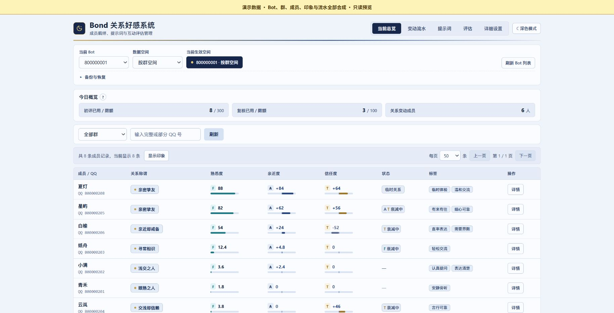
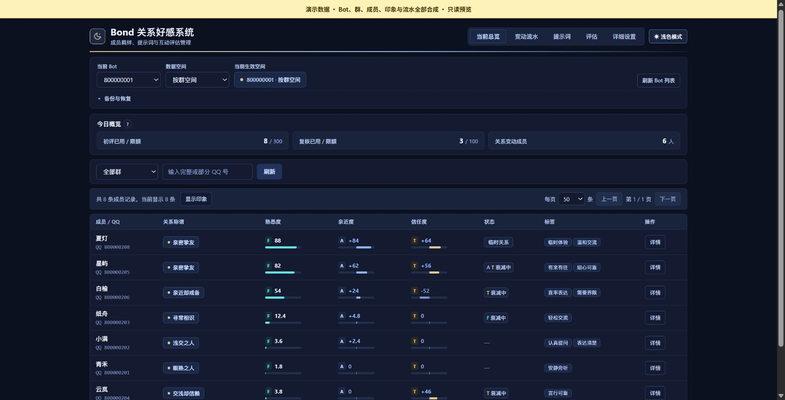
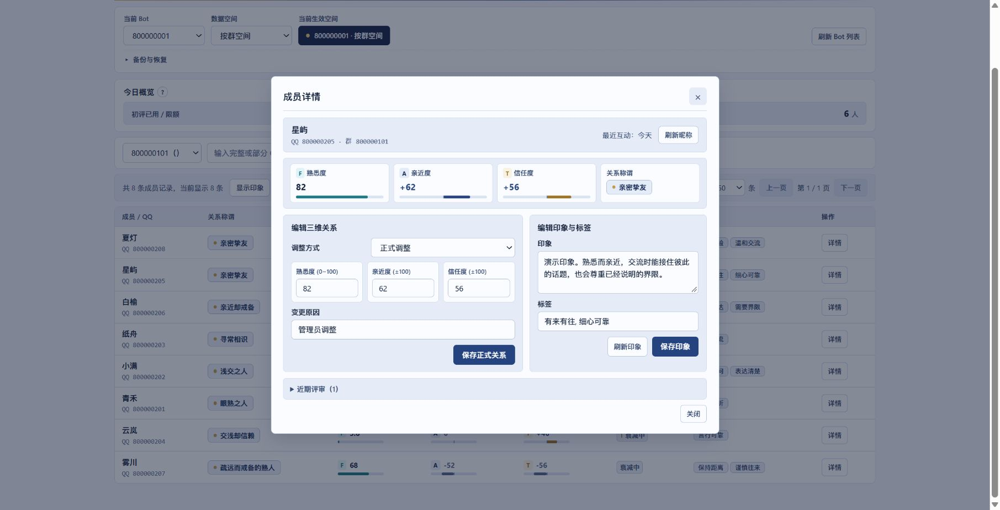

  

<h1 align="center">Bond 关系好感系统</h1>

熟悉，不一定亲近。亲近，也可以有所保留。

<strong>v0.7.0</strong> · AstrBot ≥4.28 · OneBot aiocqhttp · AGPL-3.0

Bond 为 AstrBot 的长期多人群聊保存相处状态，分别记录熟悉度 F、亲近度 A 和信任度 T，让当前人格在回复时参考。每个 Bot 独立保存关系，支持按群分别记录或同一 Bot 跨群共用。

## 主要功能

- 三维关系分别积累和淡化，支持亲近却戒备、疏远但信赖等混合状态。
- 固定词典提供 76 个关系称谓，可选动态称谓按完整人格自由表达，查询与排行复用有效缓存。
- 自动评估按事件和证据更新关系，支持印象、标签与近期事件。
- 原生管理面板提供深浅主题、成员详情、变动流水、撤销与限时关系体验。
- 群聊查询展示关系称谓，图片排行展示昵称与头像，管理面板可查看具体数值。

## 上手

1. 使用 AstrBot `>=4.28` 与 `aiocqhttp`，通过插件管理从本仓库安装。手动解压时目录须为 `data/plugins/astrbot_plugin_bond/`，保留全小写目录名。
2. 重载后打开 Bond 管理页面，连接 OneBot 并刷新 Bot 列表，选择 Bot 和数据空间。
3. 先在群里试 `/我的关系` 或 `/好感排行`。需要自动变化时，先手动选择日常评估模型，再开启自动评估。自动信任变化还需分级复核与复核模型。
4. 在“详细设置 → 个性化功能”调整回复参考与动态称谓。新安装默认在回复中体现关系，动态称谓默认关闭，固定词典直接可用。已有明确关闭回复参考的配置继续保留。

新安装默认使用 Galgame 增长模式，自动评估与诊断默认关闭。Bond 页面保存基础与详细设置后需重载，提示词保存后立即生效。完整命令、印象与管理操作见 [用户指南](docs/USER_GUIDE.md)。

## 截图

以下图片由本机原生管理页面实际渲染，Bot、群、成员、印象与流水全部为合成演示数据。

## 数据外发

启用评估、印象总结或动态称谓时，相应消息、允许的上下文、人格或关系资料会发给所选 AstrBot Provider。图片排行向固定 QQ 头像服务发送榜内至多 10 个账号以获取头像，图片在本机生成。诊断保存在本机，详细字段与范围见 [用户指南](docs/USER_GUIDE.md#数据与模型调用)。

## 文档入口

| 主题 | 文档 |
| --- | --- |
| 命令、设置与日常管理 | [用户指南](docs/USER_GUIDE.md) |
| 事件、额度、衰减与动态称谓 | [评估框架](docs/ASSESSMENT_FRAMEWORK.md) |
| 版本升级、备份与回退 | [升级说明](docs/MAINTENANCE_UPGRADE.md) |
| 称谓与表达模板 | [关系词典](docs/RELATION_LEXICON.md) · [提示词](docs/PROMPTS.md) |
| 验证范围与研究 | [验收记录](docs/ACCEPTANCE.md) · [图文短论文](docs/research/EMOTION_MODEL_PAPER.md) · [研究来源](docs/research/RESEARCH_SOURCES.md) |
| 开发、合成预览与参与 | [开发指南](docs/DEVELOPMENT.md) · [贡献指南](CONTRIBUTING.md) · [Issues](https://github.com/timeance/Astrbot_plugin_bond/issues) · [安全反馈](SECURITY.md) · [商店资料](docs/STORE_SUBMISSION.md) |

研究文献编号入口

完整 References 已移至 [评估框架](docs/ASSESSMENT_FRAMEWORK.md#references--参考资料)，以下保留旧引用的编号入口。

[1](docs/ASSESSMENT_FRAMEWORK.md#ref-01) [2](docs/ASSESSMENT_FRAMEWORK.md#ref-02) [3](docs/ASSESSMENT_FRAMEWORK.md#ref-03) [4](docs/ASSESSMENT_FRAMEWORK.md#ref-04) [5](docs/ASSESSMENT_FRAMEWORK.md#ref-05) [6](docs/ASSESSMENT_FRAMEWORK.md#ref-06) [7](docs/ASSESSMENT_FRAMEWORK.md#ref-07)
[8](docs/ASSESSMENT_FRAMEWORK.md#ref-08) [9](docs/ASSESSMENT_FRAMEWORK.md#ref-09) [10](docs/ASSESSMENT_FRAMEWORK.md#ref-10) [11](docs/ASSESSMENT_FRAMEWORK.md#ref-11) [12](docs/ASSESSMENT_FRAMEWORK.md#ref-12) [13](docs/ASSESSMENT_FRAMEWORK.md#ref-13) [14](docs/ASSESSMENT_FRAMEWORK.md#ref-14)
[15](docs/ASSESSMENT_FRAMEWORK.md#ref-15) [16](docs/ASSESSMENT_FRAMEWORK.md#ref-16) [17](docs/ASSESSMENT_FRAMEWORK.md#ref-17) [18](docs/ASSESSMENT_FRAMEWORK.md#ref-18) [19](docs/ASSESSMENT_FRAMEWORK.md#ref-19)

## 许可与来源

Bond 基于 [yiwuerxin/astrbot_plugin_xinxian](https://github.com/yiwuerxin/astrbot_plugin_xinxian)（心弦好感度）开发，保留原作者署名并沿用 GNU AGPL v3。完整许可与来源见 [LICENSE](LICENSE)、[NOTICE](NOTICE) 及 [上游 README](docs/upstream/README.xinxian.md)。

Logo 与九款排行角色插图为 AI 辅助绘制、以《超时空辉夜姬！》八千代为灵感的非官方同人素材。
