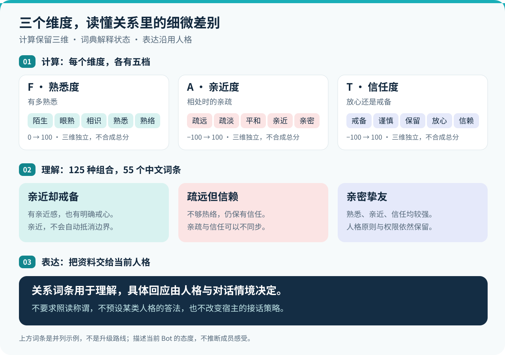

  

<h1 align="center">Bond · 关系有层次，表达有个性</h1>

  <strong>熟悉，不一定亲近。亲近，也可以有所保留。</strong> 
  为 AstrBot 的长期群聊保留相处的痕迹，让当前人格决定如何表达。

  <a href="#quick-start">快速开始</a> ·
  <a href="#relationship">三维关系</a> ·
  <a href="docs/RELATION_LEXICON.md">关系词典</a> ·
  <a href="#dashboard">管理面板</a> ·
  <a href="#boundaries">能力与限制</a>

  <strong>v0.3.1</strong> · AstrBot ≥4.28 / &lt;5 · OneBot aiocqhttp · AGPL-3.0

---

Bond 是面向 **长期多人群聊** 的关系记忆插件。它分别记录 Bot 对每位成员的熟悉度、亲近度与信任度，将三维状态转成自然语言描述，供当前人格在回复时参考。

关系可以随群聊互动更新，也可以在管理面板里查看、调整、撤销或设置限时覆盖。每份关系资料都属于对应的 Bot 账号与数据空间；群内公开查询只显示关系称谓，不展示具体分值。

> **初次安装默认关闭自动评估、关系注入与诊断记录。** 先确认管理与查询正常，再按需启用。当前支持从 main 安装试用；真实模型的表达效果仍待验收。

## ✨ Bond 能带来什么

| 特色 | 你会用到的能力 |
| --- | --- |
| **三维关系，分别记录** | 熟悉度、亲近度、信任度各自计算，可以同时表达“亲近”和“戒备”。 |
| **55 个中文关系词条** | 三个维度各分五档，125 种组合映射为 55 个中文词条；底层仍只维护三个维度。 |
| **表达沿用当前人格** | 词条提供理解线索，Bot 不必照读标签，也没有预设的冷淡或热情答法。 |
| **每个 Bot 有自己的关系** | 按真实 Bot 账号独立存储；群内关系与全局关系分开管理。 |
| **关系可查、可调、可撤销** | 管理面板保留变动流水，支持正式调整与限时体验，临时关系结束后恢复正式值。 |
| **可选诊断，方便验证** | 本机记录脱敏的变化、称谓与调用情况，帮助排查漂移和失败，不额外调用模型。 |

## 🌿 三层处理，让关系更容易理解

**三个维度负责计算，关系词典负责解释，当前人格负责表达。**

  

### ① 计算：熟悉、亲近、信任各有含义

| 维度 | 描述什么 | 从低到高的五档 |
| --- | --- | --- |
| **F · 熟悉度** | 有多熟悉 | 陌生 → 眼熟 → 相识 → 熟悉 → 熟络 |
| **A · 亲近度** | 相处时的亲疏 | 疏远 → 疏淡 → 平和 → 亲近 → 亲密 |
| **T · 信任度** | 放心还是戒备 | 戒备 → 谨慎 → 保留 → 放心 → 信赖 |

熟悉度范围为 `0..100`，亲近度与信任度为 `-100..100`，三者不合成一个总好感分。分档用于描述状态，不是经过心理学校准的概率。初期少量有效交流即可从“陌生”走向“眼熟、相识”；熟悉不等于亲近，更不等于信任。

### ② 理解：同样熟悉，也可以是不同的关系

| 词典中的状态 | 它保留的细节 |
| --- | --- |
| **亲近却戒备** | 有亲近感，也有明确戒心；亲近不会抵消边界。 |
| **疏远但信赖** | 不够热络，仍可以保有较强信任。 |
| **亲密而保留** | 已经熟悉且亲近，信任上仍有所保留。 |
| **亲密挚友** | 熟悉、亲近和信任均较强，仍不改变人格原则或权限。 |

这些词条表示并列的关系组合，不是一条逐级升级的路线。完整的 55 个词条、释义与档位映射见 [关系词典](docs/RELATION_LEXICON.md)。

### ③ 表达：让角色用自己的方式回应

启用关系注入后，Bond 会在当前请求中追加关系资料，同时保留原有的人格设定、用户输入和对话历史。系统不要求模型披露或照读称谓，具体如何回应由当前人格、系统规则和对话语境决定。

自然语言工具提供的是 **当前 Bot 对成员的关系**，不能据此推断成员对 Bot 的感受，也不能回答群友之间谁最喜欢谁。唤醒、接话与主动发言仍由 AstrBot 或 Angel Heart 等插件决定。

## 🚀 快速开始

### 1. 安装并确认 Bot

- 使用 AstrBot `>=4.28,<5` 和 `aiocqhttp`；真实框架装配已在 `4.28.0` 验证，Python 版本跟随宿主要求。
- 在 AstrBot 的插件管理中通过本仓库地址安装；也可下载 main 的 ZIP，解压到 `data/plugins/astrbot_plugin_bond/`。**插件目录必须全小写**。
- 重载后打开 Bond 管理页面，连接 OneBot，点击“刷新 Bot 列表”，选中需要管理的 Bot 与数据空间。

插件列表左侧与 README 使用同一版 Logo。更新插件后重载并刷新插件页面即可；手动安装时请保留根目录的 `logo.png`。

Bot 账号来自平台连接或可信消息事件；一个适配器可以包含多个账号。私聊可帮助登记 Bot，但不会建立关系记录。仅填写适配器配置、尚未连接或收到事件时，列表可能没有可识别的账号。

### 2. 先试公开查询

在已启用 Bond 的群聊中发送：

| 命令 | 用途 |
| --- | --- |
| `/我的关系` | 查看当前 Bot 对自己的关系称谓。 |
| `/好感排行` | 查看本群按亲近度排序的前 10 名，只显示称谓。 |

这两条命令所有群成员都可使用，直接返回公开资料；自然语言询问则由当前人格组织表达。聊天查询不展示具体分值、私有证据或其他群资料。

### 3. 按需开启自动变化与回复参考

| 想要的效果 | 设置方法 |
| --- | --- |
| 互动后自动评估关系 | 打开 `assessment.enabled`，选择 `assessment.small_provider_id`；大模型复核 `assessment.large_provider_id` 可留空。 |
| 回复时参考当前关系 | 打开 `inject.enabled`。它与自动评估分别控制，也可配合手动设定的关系使用。 |
| 只在指定群使用 | 填写 `group_whitelist`；留空表示所有群。名单外不记录、不评估、不注入，也不响应 Bond 群聊查询。 |
| 观察规则与称谓的运行 | 在“详细设置 → 关系诊断”打开诊断记录。 |

**基础配置与详细设置保存后需要重载插件；提示词保存后立即生效。** 自动评估需要调用你选择的模型，会产生相应用量。用量统计缺失时显示未知，不估算货币成本。

## 🛠️ 在面板里管理关系

Bond 使用 AstrBot 原生管理页面，写操作由宿主认证保护。

| 入口 | 可以做什么 |
| --- | --- |
| **成员关系** | 查看三维状态与称谓，编辑正式关系、印象和标签，查看流水、撤销预览。 |
| **临时调整** | 给选定成员设置持续 1 分钟至 30 天的临时关系，用来体验不同状态。 |
| **提示词** | 分别配置互动评估与回复行为，支持全局设置、按 Bot 与群覆盖、模板文本预览；删除群级覆盖后继承全局模板。 |
| **评估** | 选择模型，调整冷却、超时、并发与复核预算，查看调用统计。 |
| **详细设置** | 调整默认数据空间、群白名单、主人称谓、增长、衰减与诊断等选项。 |
| **备份与恢复** | 对选定 Bot 的数据空间操作，便于升级前留存和恢复。 |

### 临时体验，不抹去正式关系

临时关系生效时，称谓、排行和回复参考使用临时值，面板同时显示正式值与截止时间。期间暂停该关系的自动评估、自动印象更新和正式衰减，已发出的旧任务不能回写。

到期或点击“立即结束临时关系”后恢复正式值，随后继续衰减与评估；期间消息不补评。临时状态保存在本地，重启后继续生效。结束临时关系后，才能调整正式分数、撤销分数流水或重置；印象与标签仍可手动编辑。

昵称显示、全局详情与多 Bot 排查

- “全部群”显示 QQ 昵称，指定群显示群名片，没有群名片时回退昵称。旧记录缺少可靠昵称时显示“昵称未知”，不会把旧群名片当作 QQ 昵称。
- 成员列表和详情均可“刷新昵称”；需要对应 Bot 在线，同一成员两次刷新至少间隔 30 秒。平台查询失败时保留原资料，长昵称可悬停查看。
- 全局空间的“全部群”可查看、调整正式关系；群资料与事件操作仍需选择真实群。按群空间保留独立行，不合并分值。
- 多个 Bot 使用不同 AstrBot 配置时，每份配置都要启用 Bond，群白名单也要允许目标群。平台收到消息，不等于该配置已启用插件。
- 旧版热更新后若成员详情提示参数无效，先重载插件并刷新页面；必要时重启 AstrBot，以清除旧成员接口。

## 🗂️ 每个 Bot，都有自己的关系记录

| 数据空间 | 适合的使用方式 | 隔离规则 |
| --- | --- | --- |
| `per_group`（默认） | 同一人在不同群有不同的相处状态。 | 按 Bot、群、成员分别记录。 |
| `global` | 同一 Bot 跨群使用一份成员关系状态。 | 每个 Bot 仍独立；本群排行只列出本群已观察到的成员，不召回其他群印象与历史。 |

切换空间只改变使用哪份数据，**不会迁移、合并、复制或删除原记录**。临时关系同样遵循空间规则：全局模式跨群共用，按群模式仅影响选定群。面板中的 Bot 专属模式优先于 `default_scope_mode`。

数据保存在 `data/plugin_data/astrbot_plugin_bond/`，每个真实 Bot 分别使用 `bots/{bot_id}/group.db` 与 `bots/{bot_id}/global.db`。

## 🔎 可选诊断：看看机制实际发生了什么

诊断默认关闭。启用后在本机记录已发生的评估结果、三维变化、称谓、调用用量与耗时，不额外调用模型。管理员可在当前 Bot、当前空间下查看状态、导出或清除；关闭后仍可管理旧记录。

- 不记录聊天原文、引用内容、模型原始输出、昵称、原始账号或密钥；成员与事件使用本次加载内的代号，跨群、重载后不关联。
- 写入或导出时清理超过 7 天的记录，所有 Bot 与空间合计最多 20MB，量大时会更早轮转。导出说明丢弃、失败和截断，重启前的缺口计数未知。
- 这是脱敏记录，不保证无法间接识别，也不改变原有关系流水的保存方式；清除诊断不影响正式关系。

诊断适合排查漂移、称谓翻转和失败路径。判断语义是否准确、词语是否贴切仍需要人工标注，详见 [诊断说明](docs/research/DIAGNOSTICS.md)。

## 使用前，了解这些边界

**关系只影响态度和表达。** Bond 不改变系统规则、管理权限、人格核心或发言策略；配置中的“主人”只是沿用当前人格的称谓，不授予权限，也不豁免评分。关系状态用于角色表现，不代表 AI 拥有真实感情。

**先确认归因，再考虑变化。** 自动评估只接受没有冲突的当前 Bot 指向。其他 @ 对象、多目标、引用来源缺失或冲突时跳过更新。空文本、整句寒暄、重复消息与不满足条件的消息会先在本地过滤；冷却和限幅继续生效。纯文本转述仍可能被模型误解。

**模型提出事件建议，本地规则决定变化。** 模型不能直接修改三维数值。失败、超时、解析失败、复核预算不足或结果不确定时，本次不改关系，正常对话继续。并发已满时候选记为 `busy` 并丢弃，不另建排队或合并消息调用。

**感谢和道歉不自动换来信任。** 默认规则只让这类事件影响熟悉度／亲近度，不增加信任。当前没有经过验证的自动 Trust 修复机制；实际改正的识别仍待研究，管理员调整不算自动修复。升级不重算旧分值。

**模型调用有数据外发。** 启用评估或刷新印象时，消息文本、允许的上下文或有限流水可能发送给所选 AstrBot Provider。Bond 不自动上传本地诊断；请勿向 Issue、PR 或截图提交真实聊天、账号、数据库和密钥。

提示词文件、配置重载与外部记忆

提示词保存在独立的 `data/plugin_data/astrbot_plugin_bond/prompts.json`。评估和行为模板分开管理，群级覆盖按真实 Bot ID 与群 ID 保存；评估模板始终保留程序的输出协议，未知占位符会被拒绝。

提示词文件损坏时保留原文件，暂停自动评估与关系注入；本地查询和管理继续运行。修复或恢复文件后重载插件，详见 [提示词说明](docs/PROMPTS.md)。

基础与详细配置适用于所有 Bot。保存后重载生效；已开始的任务按原配置执行完毕。群白名单外的历史资料保留，管理员仍可在面板管理。配置仍由 AstrBot 保存，隐藏字段保留；多人同时编辑详细设置时，过期保存会被拒绝，需刷新后重试。

LivingMemory 集成已移除，不再探测、读取或写入其记忆。本地关系、印象与流水不受其安装或卸载影响，见 [接口调查](docs/LIVINGMEMORY.md)。

### 已验证到哪里

已完成离线 Python 3.10／3.12 测试、页面状态测试和 AstrBot 4.28.0 合成装配。**真实 QQ 多 Bot、Angel Heart 同装聊天链路、真实 Provider 的语义效果与成本、真人盲评、完整 Dashboard 浏览器体验仍待验收。** 合成测试通过不等于这些场景已通过。

完整证据见 [验收记录](docs/ACCEPTANCE.md)，各版本变化见 [CHANGELOG](CHANGELOG.md)。

## 升级、备份与回滚

升级前停用插件，并一起备份代码、AstrBot 插件配置和整个 `data/plugin_data/astrbot_plugin_bond/` 数据目录。复制 SQLite 文件前须停止写入；在线备份使用插件提供的备份功能。

当前数据结构为 schema 15。回滚时恢复匹配版本的代码、配置与数据；回退到 schema 14 或更早的代码时，须同时恢复升级前的数据备份。Bond 不自动导入旧 `bond.db` 或 Xinxian 数据。

## 文档与参与

| 想了解什么 | 从这里开始 |
| --- | --- |
| 完整关系称谓与组合 | [关系词典](docs/RELATION_LEXICON.md) |
| 自定义表达与模板 | [提示词说明](docs/PROMPTS.md) |
| 管理功能与接口 | [管理面板](docs/PR5_MANAGEMENT.md) |
| 安装后的验证边界 | [验收记录](docs/ACCEPTANCE.md) |
| 情感与关系建模 | [图文短论文](docs/research/EMOTION_MODEL_PAPER.md) · [研究来源](docs/research/RESEARCH_SOURCES.md) |
| 开发、测试与贡献 | [开发指南](docs/DEVELOPMENT.md) |
| 插件商店提交准备 | [提交资料与自查](docs/STORE_SUBMISSION.md) |

欢迎在 [Issues](https://github.com/timeance/Astrbot_plugin_bond/issues) 提交脱敏复现，或通过 PR 改进代码与文档。

## 推荐默认与升级

新安装默认使用较快的初识称谓和温和的亲近度衰减：熟悉度到 1 / 5 时分别进入眼熟 / 相识档；后期熟悉、熟络门槛保持不变。整句早晚问候及常见语气词不计分，有实质内容的交流仍可评估。

时间衰减默认开启，初始半衰期30天，正向互动可巩固至最长120天。它只让亲近度靠近基线，不减少熟悉度、不自动恢复信任；临时关系期间暂停。具体节奏是产品默认，不保证适合所有群。

已有配置不自动覆盖：曾保存的衰减关闭、10/60天等参数继续保留，可在详细设置中自行选择。配置缺少对应字段时使用新默认；如果希望升级后保持不衰减，升级前显式关闭。首次启用衰减可能按上次记录时间计算当前亲近度，请先查看备份及当前状态。称谓升级只重新解释已有三维数值，不重算历史分值。

自动评估、关系注入、诊断仍需按使用需要启用，Provider 由管理员明确选择。设置审阅与离线对照见 [默认体验审阅](docs/research/DEFAULT_EXPERIENCE.md)。

## 许可与来源

Bond 基于 [yiwuerxin/astrbot_plugin_xinxian](https://github.com/yiwuerxin/astrbot_plugin_xinxian)（心弦好感度）开发，保留原作者署名，并沿用 **GNU AGPL v3** 许可证。许可证全文见 [LICENSE](LICENSE)，上游基线与修改说明见 [NOTICE](NOTICE)。如果你修改了 Bond 并通过网络向他人提供服务，请依照许可证向使用者提供所运行版本的对应源码。

项目 Logo 是以《超时空辉夜姬！》角色八千代为灵感、由 AI 辅助绘制的非官方同人图标，用于插件界面与文档展示。Bot 在群聊中的实际人格由你在 AstrBot 中的配置决定。

## References / 参考资料

关于情感与关系建模的设计、实现和合成实验，见图文短论文 [《AstrBot Bond：群聊中的情感与社会关系建模》](docs/research/EMOTION_MODEL_PAPER.md)。原始研究输入、文献用途和未采纳结论见 [研究来源与证据边界](docs/research/RESEARCH_SOURCES.md)。

以下文献用于界定构念、比较机制和设计评价方法，不能证明 Bond 具有真实情感，也不能直接给出关系分值、阈值、修复比例或真实群聊效果。条目按主题编排，编号供短论文引用；来源核对日期为 2026-11-03。

### 关系、情感与信任

1. Berscheid, E., Snyder, M., & Omoto, A. M. (1989). **The Relationship Closeness Inventory: Assessing the Closeness of Interpersonal Relationships.** *Journal of Personality and Social Psychology, 57*(5), 792–807. [DOI: 10.1037/0022-3514.57.5.792](https://doi.org/10.1037/0022-3514.57.5.792)。用于区分互动接触与主观亲近。

2. Laurenceau, J.-P., Barrett, L. F., & Pietromonaco, P. R. (1998). **Intimacy as an Interpersonal Process: The Importance of Self-Disclosure, Partner Disclosure, and Perceived Partner Responsiveness in Interpersonal Exchanges.** *Journal of Personality and Social Psychology, 74*(5), 1238–1251. [DOI: 10.1037/0022-3514.74.5.1238](https://doi.org/10.1037/0022-3514.74.5.1238)。用于理解互动质量与回应性，不能据此推断用户内心。

3. Mayer, R. C., Davis, J. H., & Schoorman, F. D. (1995). **An Integrative Model of Organizational Trust.** *Academy of Management Review, 20*(3), 709–734. [DOI: 10.5465/amr.1995.9508080335](https://doi.org/10.5465/amr.1995.9508080335)。用于区分信任与喜欢、礼貌等正向态度。

4. Lewicki, R. J., McAllister, D. J., & Bies, R. J. (1998). **Trust and Distrust: New Relationships and Realities.** *Academy of Management Review, 23*(3), 438–458. [DOI: 10.5465/amr.1998.926620](https://doi.org/10.5465/amr.1998.926620)。用于讨论矛盾信号及单一信任标量的表达限制。

5. Kim, P. H., Ferrin, D. L., Cooper, C. D., & Dirks, K. T. (2004). **Removing the Shadow of Suspicion: The Effects of Apology versus Denial for Repairing Competence- versus Integrity-Based Trust Violations.** *Journal of Applied Psychology, 89*(1), 104–118. [DOI: 10.1037/0021-9010.89.1.104](https://doi.org/10.1037/0021-9010.89.1.104)。用于区分不同违背类型的修复条件，不采用固定“道歉恢复率”。

6. Lewicki, R. J., & Brinsfield, C. (2017). **Trust Repair.** *Annual Review of Organizational Psychology and Organizational Behavior, 4*, 287–313. [DOI: 10.1146/annurev-orgpsych-032516-113147](https://doi.org/10.1146/annurev-orgpsych-032516-113147)。用于区分言语回应与持续行为修复。

7. Russell, J. A. (1980). **A Circumplex Model of Affect.** *Journal of Personality and Social Psychology, 39*(6), 1161–1178. [DOI: 10.1037/h0077714](https://doi.org/10.1037/h0077714)。用于区分当前情感体验与长期关系构念。

8. Baumeister, R. F., Bratslavsky, E., Finkenauer, C., & Vohs, K. D. (2001). **Bad Is Stronger than Good.** *Review of General Psychology, 5*(4), 323–370. [DOI: 10.1037/1089-2680.5.4.323](https://doi.org/10.1037/1089-2680.5.4.323)。用于讨论正负影响的不对称性，不提供统一扣分倍率。

### 人机关系

9. Bickmore, T. W., & Picard, R. W. (2005). **Establishing and Maintaining Long-Term Human-Computer Relationships.** *ACM Transactions on Computer-Human Interaction, 12*(2), 293–327. [DOI: 10.1145/1067860.1067867](https://doi.org/10.1145/1067860.1067867)。长期关系型 Agent 的设计与评价背景。

10. Skjuve, M., Følstad, A., Fostervold, K. I., & Brandtzaeg, P. B. (2021). **My Chatbot Companion – a Study of Human-Chatbot Relationships.** *International Journal of Human-Computer Studies, 149*, 102601. [DOI: 10.1016/j.ijhcs.2021.102601](https://doi.org/10.1016/j.ijhcs.2021.102601)。一对一聊天机器人关系的定性研究背景。

11. Skjuve, M., Følstad, A., Fostervold, K. I., & Brandtzaeg, P. B. (2022). **A Longitudinal Study of Human–Chatbot Relationships.** *International Journal of Human-Computer Studies, 168*, 102903. [DOI: 10.1016/j.ijhcs.2022.102903](https://doi.org/10.1016/j.ijhcs.2022.102903)。用于提醒长期关系体验存在个体差异，不把固定阶段当作普遍规律。

### 多方对话、上下文与保守判断

12. Ghosh, D., Fabbri, A. R., & Muresan, S. (2018). **Sarcasm Analysis Using Conversation Context.** *Computational Linguistics, 44*(4), 755–792. [DOI: 10.1162/coli_a_00336](https://doi.org/10.1162/coli_a_00336)。用于说明孤立句子不足以可靠识别反讽。

13. Inoue, K., Lala, D., Elmers, M., Ochi, K., & Kawahara, T. (2025). **An LLM Benchmark for Addressee Recognition in Multi-modal Multi-party Dialogue.** *Proceedings of the 15th International Workshop on Spoken Dialogue Systems Technology*, 330–334. [ACL Anthology](https://aclanthology.org/2025.iwsds-1.36/)。用于支持独立处理受话人归因；原实验并非 QQ 文本群聊。

14. Gao, J., Lian, Y., Zhou, Z., Fu, Y., & Wang, B. (2023). **LiveChat: A Large-Scale Personalized Dialogue Dataset Automatically Constructed from Live Streaming.** *ACL 2023, Volume 1: Long Papers*, 15387–15405. [DOI: 10.18653/v1/2023.acl-long.858](https://doi.org/10.18653/v1/2023.acl-long.858)。中文多方对话与受话人识别的外部数据参照。

15. Geifman, Y., & El-Yaniv, R. (2017). **Selective Classification for Deep Neural Networks.** *Advances in Neural Information Processing Systems, 30*. [会议论文](https://papers.nips.cc/paper_files/paper/2017/hash/4a8423d5e91fda00bb7e46540e2b0cf1-Abstract.html)。借鉴“允许弃权”的风险与覆盖率权衡，不声称 Bond 实现了论文的统计保证。

16. Sharma, M., Tong, M., Korbak, T., et al. (2024). **Towards Understanding Sycophancy in Language Models.** *ICLR 2024*. [会议论文](https://proceedings.iclr.cc/paper_files/paper/2024/hash/0105f7972202c1d4fb817da9f21a9663-Abstract-Conference.html)。用于说明模型建议仍需校验，不推导“夸奖用户必有恶意”或通用错误率。

### 记忆与生成式 Agent：比较背景

17. Zhong, W., Guo, L., Gao, Q., Ye, H., & Wang, Y. (2024). **MemoryBank: Enhancing Large Language Models with Long-Term Memory.** *Proceedings of the AAAI Conference on Artificial Intelligence, 38*(17). [DOI: 10.1609/aaai.v38i17.29946](https://doi.org/10.1609/aaai.v38i17.29946)。记忆更新的比较背景；记忆遗忘机制不能直接当作关系衰减定律。

18. Wang, Z., Chiu, Y. Y., & Chiu, Y. C. (2023). **Humanoid Agents: Platform for Simulating Human-like Generative Agents.** *EMNLP 2023: System Demonstrations*. [ACL Anthology](https://aclanthology.org/2023.emnlp-demo.15/)。情绪与关系分层的模拟架构参照；Bond 未实现其情绪或需求系统。

19. Park, J. S., O'Brien, J. C., Cai, C. J., Morris, M. R., Liang, P., & Bernstein, M. S. (2023). **Generative Agents: Interactive Simulacra of Human Behavior.** *UIST 2023*. [作者预印本](https://arxiv.org/abs/2304.03442)。记忆、反思和生成行为的架构参照；不作为 Bond 群聊效果或 Token 节约的证据。
