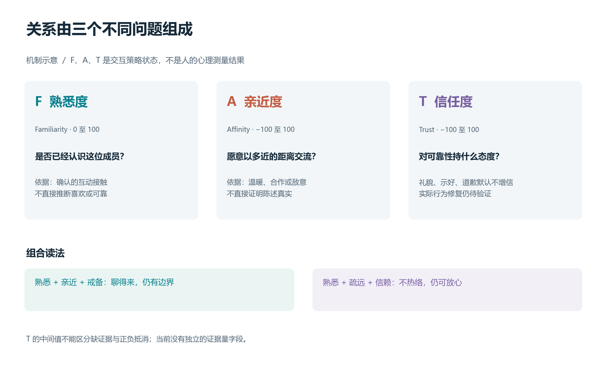
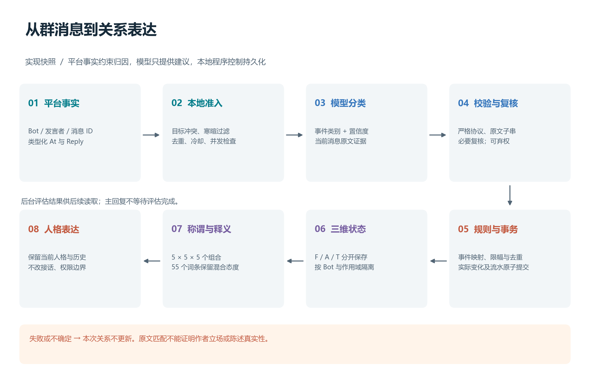
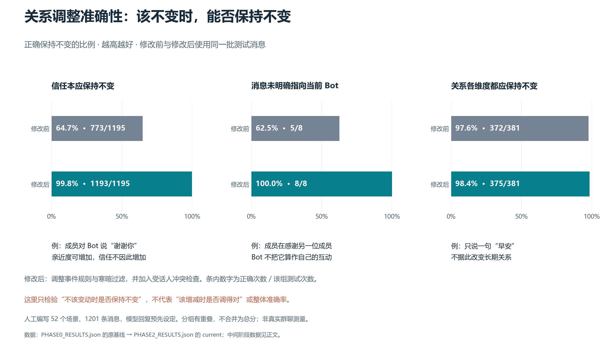

# AstrBot Bond：群聊中的情感与社会关系建模

**面向可解释交互策略的设计与合成实验短论文**

2026-11-03 · 实现快照：0.2.6，main 提交 `daf74a66e0934acc318c1c5d21813636b3efb59d`。本文描述该快照的行为；阶段实验沿用各自冻结结果，不把它们当作本次新运行的实测。

## 摘要

AstrBot Bond 为群聊 Bot 保存对不同成员的关系状态，使同一人格能够表现出持续而有区别的态度。项目将关系拆为熟悉度、亲近度和信任度：平台元数据确定互动对象，语言模型提出事件类别及原文证据，本地规则与事务决定长期变化，关系词典再把状态转为适合当前人格使用的资料。情感部分的主要成果是将互动接触、温暖态度和可靠性判断分开，并取消礼貌与口头道歉的默认增信。52 个合成场景、每臂 1201 条事件的归档回放中，在信任本应保持不变的消息里，正确处理比例由 64.7% 升至 99.8%；在所有关系维度都应不变的消息里，由 97.6% 升至 98.4%。这衡量“不该调整时是否保持不变”，不等于整体关系调整准确率。这些结果验证固定输入下的规则与路由变化；真实群聊语义准确率、人格体验和自动信任修复尚未得到验证。

**关键词：** 群聊 Agent；情感交互；社会关系；信任；事件归因；选择性更新

## 1. 问题与研究依据

群聊中的一句“谢谢你”可能指向另一位成员；一段攻击性文字可能是引用；熟人调侃也可能与字面情绪相反。将每条消息的正负情绪直接累加，会把归因错误长期保存下来。多方对话与反讽研究分别提示：受话人和上下文需要单独处理，而不是隐藏在一个笼统的情感判断里。[12](../../README.md#ref-12)、[13](../../README.md#ref-13)、[14](../../README.md#ref-14)

关系研究还提供了构念区分。接触频率、互动质量和亲密体验并不等价；信任研究关注风险下的可靠性预期，也区别于一般正向态度。[1](../../README.md#ref-01)、[2](../../README.md#ref-02)、[3](../../README.md#ref-03) 人机关系研究说明长期互动值得设计和评价，但没有证明 F/A/T 是人的完整心理结构，或某组分值适合所有群体。[9](../../README.md#ref-09)、[10](../../README.md#ref-10)、[11](../../README.md#ref-11)

据此，Bond 将“情感”操作化为**Bot 对当前成员的交互策略状态**，不测量用户真实感情，也不赋予 Bot 主观情绪体验。[PRD](../PRD.md) 确定了产品目标；两份初始研究与交叉评审 RFC 提供候选机制，当前源码与归档实验决定哪些内容可以写作已完成成果。材料对应见 [来源说明](RESEARCH_SOURCES.md)。

## 2. 三维关系：认识、亲近和信任分别表达

对 Bot、数据空间和成员确定的一条关系，内部状态为：

$$
R=(F,A,T),\qquad F\in[0,100],\quad A,T\in[-100,100].
$$

| 维度 | 当前操作含义 | 不应由它直接推断的内容 |
| --- | --- | --- |
| 熟悉度 F | 已确认互动所形成的接触与识别程度 | 喜欢、可靠性、管理权限 |
| 亲近度 A | 愿意亲近、交流或保持距离的态度 | 对陈述真实性的确认 |
| 信任度 T | 对可靠性、诚实与边界尊重的策略性估计 | 已被外部核实的人格或道德结论 |

*图 1. 三维关系是不同问题的状态描述，不合成为总分。图中组合是解释性示意，不代表观察到了某位用户的真实心理。[SVG 矢量版](figures/bond-dimensions.svg)。*

这一表示允许“熟悉但疏远”“亲近却戒备”等混合态度。数据按真实 Bot 账号隔离；`per_group` 再按群分开，`global` 则让同一 Bot 跨群使用一份关系。切换模式只切换读取空间，不能把跨群关系共享理解为可以披露其他群的印象或原文。

当前的 T 仍是标量。T=0 无法单独区分缺证据、正负抵消与历史缺失；公开词典使用“保留”等态度措辞，不把中间值宣称为“已经确定中立”。信任与不信任可并存的理论提供了研究动机，[4](../../README.md#ref-04) 但不足以直接证明需要五维概率模型。

当前情感体验与长期关系也是不同构念。[7](../../README.md#ref-07) Bond 目前没有独立的短期情绪缓冲器；报告中的 mood、Beta/Gaussian 分布和违背事件状态机仍是研究候选。亲近度可选时间衰减是工程设置，不能称为已经验证的人际心理规律；F 和 T 不因普通沉默按同一曲线下降。[17](../../README.md#ref-17)

## 3. 方法：从群消息到可追溯的关系变化

*图 2. 模型负责语义建议，本地程序控制持久化。失败、歧义或缺少必要复核时，本次关系不更新；正常聊天仍由宿主决定。图中箭头表示依赖关系，不保证后台评估在当前回复前完成。[SVG 矢量版](figures/bond-pipeline.svg)。*

### 3.1 先确定这句话是否对当前 Bot 说

`api/listeners.py::_chain_flags` 使用类型化的 At/Reply 组件。存在其他 @ 对象、Reply 作者不匹配、来源缺失或多个不同引用来源时，整个候选退出关系评估。昵称和正文中自称的身份不能改写 Bot、发言者或目标身份。

随后进行整句寒暄过滤、事件去重、冷却、临时覆盖与并发检查。寒暄归一化仅用于比较，模型校验证据仍使用原文。满负荷候选被跳过，不额外排队。这样的保守选择借鉴了“覆盖率与错误风险可以权衡”的原则；Bond 没有实现选择性分类论文中的概率保证。[15](../../README.md#ref-15)

目标门控也有代价：一条有多个目标、但人类能理解的自然消息可能被漏掉。当前实现优先避免把旁观内容错误写成 Bot 与发言者的长期关系。

### 3.2 模型输出事件，不输出分数

当前协议只有 `event_type`、`confidence`、`evidence` 三个字段。类别限定为九种；证据必须是当前消息的非空连续原文。高误判风险类别进入已有复核路径；没有可用复核或最终置信度不足时弃权。自动路径没有把模型自报置信度乘成更新幅度，也没有接受模型输出的目标分数。

这限制了模型建议的权限，但原文子串校验仅证明“文字存在”，不能证明“这些话由发言者认同”或“陈述属实”。模型迎合研究同样支持审慎处理建议，而不支持凭夸奖频率推断恶意。[16](../../README.md#ref-16)

### 3.3 用不同事件证据更新不同维度

下表摘自 `RelationPolicy.DEFAULT_RULES`。数值是**基础请求增量**，最终变化还受亲近度经济规则、单事件上限、每日额度、边界及事务校验影响。

| 事件 | ΔF | ΔA | ΔT | 设计含义 |
| --- | ---: | ---: | ---: | --- |
| 普通问答 | +0.1 | 0 | 0 | 发生接触，不直接推断亲近 |
| 感谢 | +0.2 | +0.5 | 0 | 接受善意，不把礼貌当可靠性 |
| 示好 | +0.3 | +0.8 | 0 | 温暖态度与信任分开 |
| 道歉 | +0.1 | +0.7 | 0 | 可改善互动气氛，不自动修复信任 |
| 正常批评 | +0.1 | 0 | 0 | 批评不等于敌意 |
| 辱骂 / 操纵 | 0 / 0 | −1.0 / −0.5 | −1.5 / −2.0 | 沿用当前负向策略，语义诊断性仍有限 |
| 无法判断 | 0 | 0 | 0 | 不把不确定性写成确定关系 |

信任修复实验与综述说明，违背类型、归因和后续行为会影响修复效果。[5](../../README.md#ref-05)、[6](../../README.md#ref-06) Bond 的已完成改动是取消感谢、示好和道歉的默认增信；它尚未实现对履约或实际改正的可靠识别，当前默认自动规则也没有正向 T 事件。因此不能声称“信任修复已经完成”。历史 T 不随升级重算，管理员调整也不算自然修复。

持久化可概括为：

$$
R_{t+1}=\operatorname{Commit}\bigl(R_t,\operatorname{Limit}(\operatorname{Policy}(e_t))\bigr).
$$

这里的 Commit 表示 `FavorService` 和 SQLite 共同执行的事务流程，不是另一个模型。实际变化、额度、去重和流水保持一致；临时关系与版本检查阻止旧后台任务回写。单事件默认上限为 F=1、A=2、T=2；这类参数是可审查的产品规则，不能从心理学论文直接推出。[8](../../README.md#ref-08)

### 3.4 关系语义与人格表达分开

当前默认词典将 F/A/T 分别分为五档，以 55 个词条覆盖 125 个组合。称谓由有效状态实时推导，不另存一份“朋友等级”。公开命令显示称谓；聊天注入同时提供释义与分档描述，让模型保留“亲近但戒备”的两个方面。详见 [完整词典](../RELATION_LEXICON.md)。

Bond 向现有请求追加关系资料，保留 AstrBot 当前人格、用户输入和历史；自然语言查询也不要求模型照读称谓。同一状态可由不同人格表达，但关系不决定是否接话、不授予权限，也不自动创建主人或恋人身份。当前实现没有人格化评分矩阵或称谓滞回；55 个词条的存在不等于真人已经认可其自然度。

## 4. 结果：关系调整是否准确

归档实验复用真实监听入口、评估服务、关系服务和 SQLite，框架消息对象与 Provider 使用替身，模型返回事先固定的响应。52 个场景包含 1201 条事件，覆盖跨日问候、正常问答、目标冲突、引用、玩笑、道歉、临时覆盖等。各阶段保持同一夹具内容；阶段源码变化由结果中的文件指纹标识。

关系调整的准确性需要分别回答两个问题：**不该调整时有没有保持不变，以及该调整时有没有调对。** 现有归档足以展示第一部分：预先标明哪些消息不应改变关系或信任，再检查程序实际是否保持不变。第二部分还涉及该增加还是减少、应改变哪个维度、幅度是否恰当，不能由第一部分推算。

例如，成员对 Bot 说“谢谢你”，可以增加亲近度，但不应据此增加信任；如果这句感谢是对另一位成员说的，Bot 与发言者的关系就不应变化。图 3 将这种“该不变时做对了多少”直接表示为比例：正确次数 ÷ 该组本应不变的测试次数。

*图 3. 不该调整时，系统正确保持不变的比例。修改前为 Phase0 原基线，修改后为 Phase2；三组均使用 0–100% 尺度，条内保留正确次数与分母。例句说明规则含义，不代表各组只含这一类消息。这里只评估人工场景中的局部正确性，不是整体关系调整准确率，也不是实际模型的语义准确率；受话人组仅有 8 条测试，100% 不可外推为真实群聊零错误。[SVG 矢量版](figures/bond-replay-results.svg)。*

具体而言，信任本应保持不变的 1195 条消息中，正确处理从 773 条增加到 1193 条（64.7% → 99.8%）；不指向当前 Bot 或对象不明的 8 条消息中，从 5 条增加到 8 条（62.5% → 100.0%）；所有关系维度都应保持不变的 381 条消息中，从 372 条增加到 375 条（97.6% → 98.4%）。分组有重叠且关注的维度不同，不合并成一个总准确率。

为便于核对，下面保留各阶段的原始错误计数与调用次数：

| 指标 | 原基线 | Phase1：规则与寒暄过滤 | Phase2：再加入目标冲突门控 |
| --- | ---: | ---: | ---: |
| 不应更新却产生持久变化 | 9/381 | 9/381 | 6/381 |
| 其他 / 不明受话人误更新 | 3/8 | 3/8 | 0/8 |
| Trust 应保持零变化却被更新 | 422/1195 | 5/1195 | 2/1195 |
| 预置 Provider 调用次数，含复核 | 730 | 498 | 492 |

数据分别来自 [Phase0 baseline](PHASE0_RESULTS.json)、[Phase1 right/current](PHASE1_RESULTS.json)、[Phase2 right/current](PHASE2_RESULTS.json)。PFUR 的分母是被标为不应更新的 381 条事件；Trust 指标的 1195 条来自另一套零变化条件，二者不能混用或相减。调用次数也不是实际 Token 或货币费用。

结果支持两项有限结论：第一，分离礼貌与信任可以消除固定输入中大部分无依据增信；第二，可信元数据的冲突否决可以阻止这组目标错误。Phase2 仍有 6 条本应不变的消息改动了长期关系，说明纯文本引文、玩笑和负向事件诊断性尚未解决。每条事件也不是独立随机样本，不据此给出人群推断或统计显著性。

后续 [引用候选实验](REMAINING_EVIDENCE.md) 进一步暴露了保守规则的代价：按引号位置拒绝证据，在新增 20 条合成样本中挡住 8/8 条错误更新，同时抑制 5/12 条应更新互动，其中包含自引感谢与代码提问。因此该候选被搁置，没有包装成生产改进。

## 5. 讨论与局限

情感部分可交付的成果，集中在**关系维度分工、礼貌与信任解耦、目标归因门控以及人格兼容的表达接口**。这些变化使规则和错误更容易追踪，尚不能证明 Bot 的情感体验更真实或用户体验更自然。

另一项研究结果是确认了现有证据的不足。[流水派生实验](TRUST_EVIDENCE_SHADOW.md) 可以核对来源、分区、撤销及缺失，却不能仅凭旧 T 正负还原可靠性事实。13 个合成场景的来源一致性检查通过，只说明离线表示可追溯；证据摘要相对计数的语义收益仍未知。生产级 evidence 字段、自动修复状态机和五维重构因而没有继续推进。生成式 Agent 与情绪模拟工作提供比较背景，[18](../../README.md#ref-18)、[19](../../README.md#ref-19) 不能替代 Bond 自己的验证。

后续评价需要获许可的脱敏群聊窗口，由多人独立标注受话者、引用归属、是否应更新及信任诊断性；再对同一历史下的回复做盲评，观察自然度、过度亲近、过度戒备和人格一致性。目前真实 QQ、多 Bot 长期运行、联网 Provider、Angel Heart 同装聊天及完整浏览器流程仍未验收。诊断记录可提供实际变化和调用信息，但没有独立标注就不能计算真实语义准确率。

## 6. 结论

Bond 以三维关系状态保存互动差异，用平台事实约束归因，用模型解释文本，用本地规则控制长期变化，再由当前人格表达。现有证据支持“礼貌不等于可信”和“目标冲突时不更新”这两项工程修正；关系证据不足、自动信任修复与真实表达效果仍是开放问题。新增状态是否值得保留，应由可复现的语义与用户评价决定。

## 参考文献与复现入口

正文编号对应 [README 最下方的 References](../../README.md#references)，完整研究输入与引用限制见 [研究来源与证据边界](RESEARCH_SOURCES.md)。图 1、图 2 为依据当前代码绘制的原创机制示意，图 3 为归档结果的可复现绘图；生成方式见 [配图说明](figures/README.md)。

关键实现入口：[目标归因](../../api/listeners.py)、[事件协议](../../core/assessment.py)、[后台评估](../../services/assessment_service.py)、[三维规则](../../core/relation_policy.py)、[统一关系服务](../../services/favor_service.py)、[关系词典](../../core/relation_lexicon.py)、[人格资料注入](../../services/inject_service.py)。研究或设计建议不替代这些文件中的实际行为。
